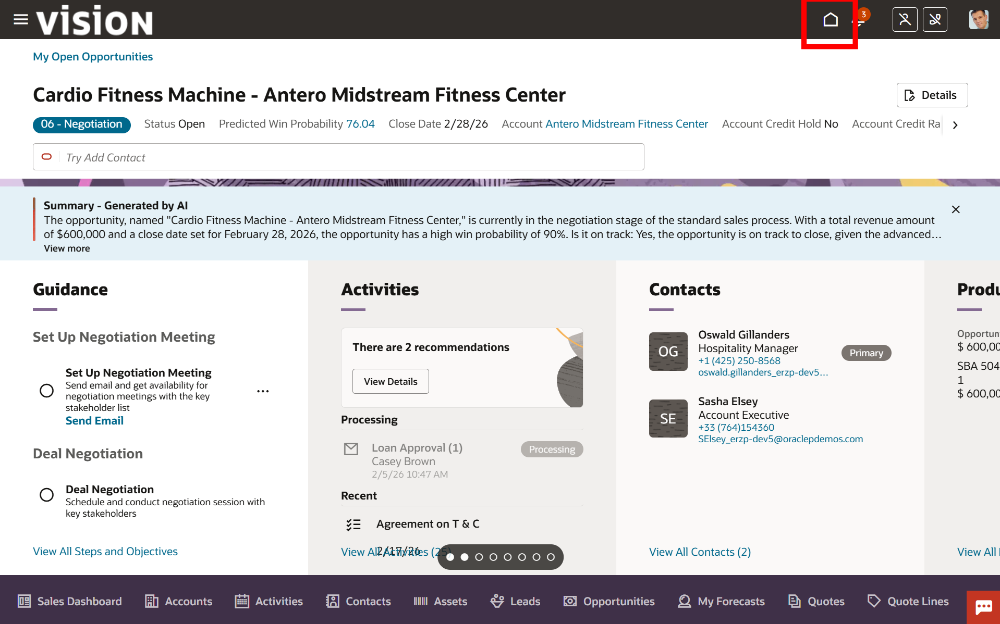
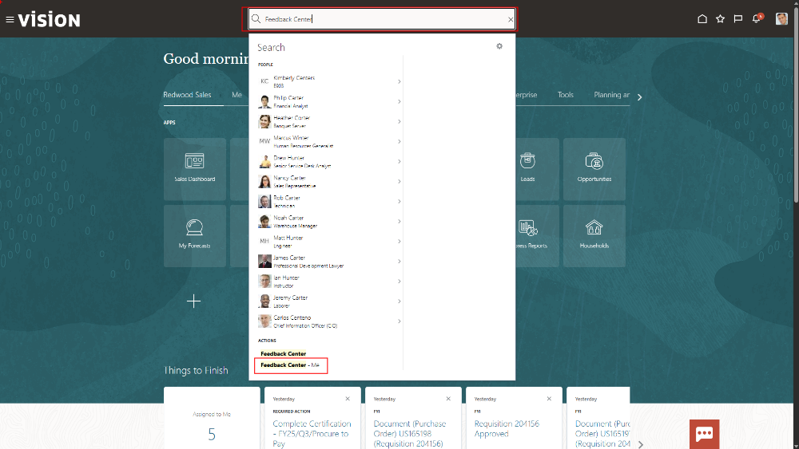
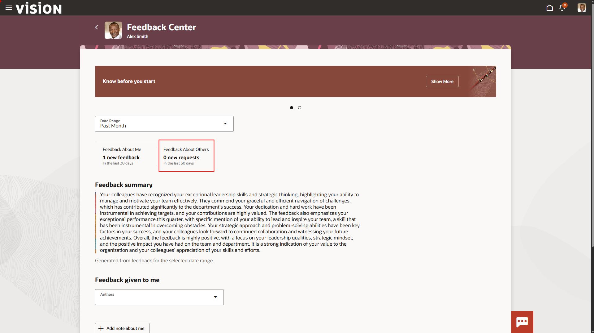
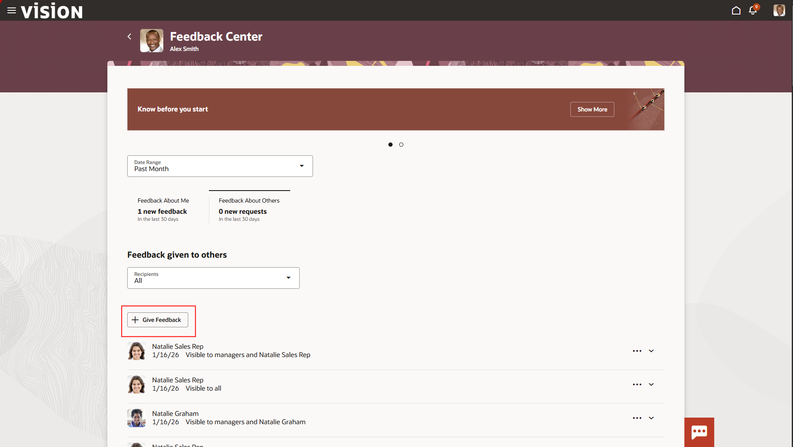
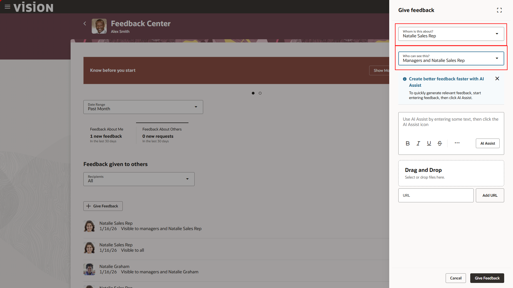
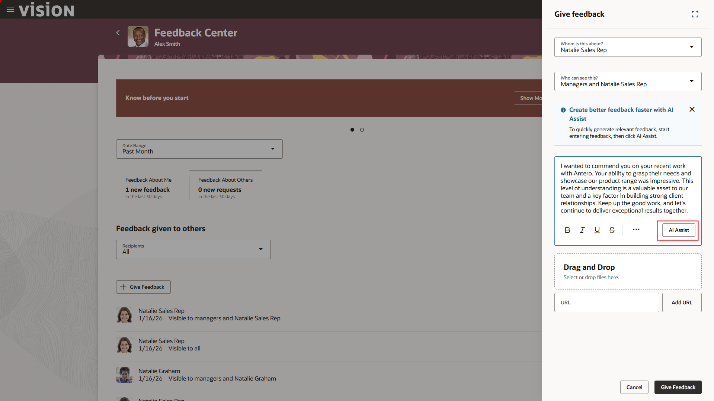
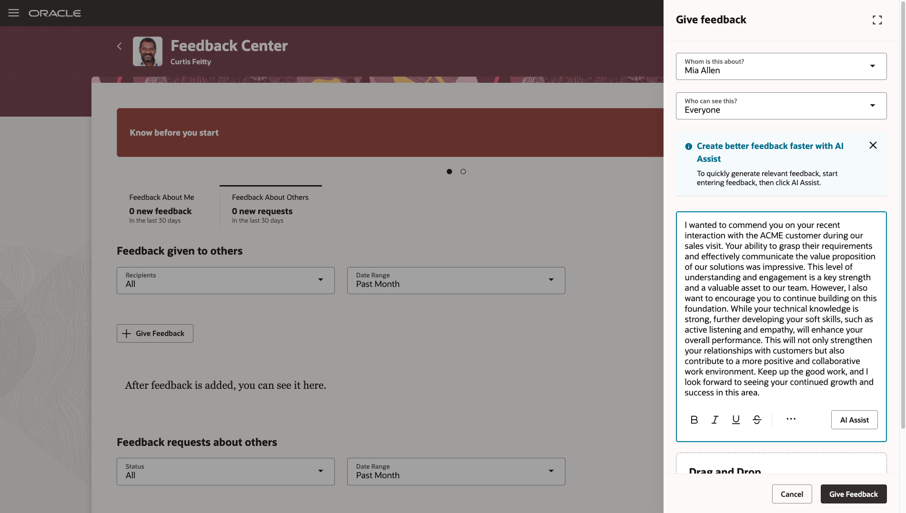
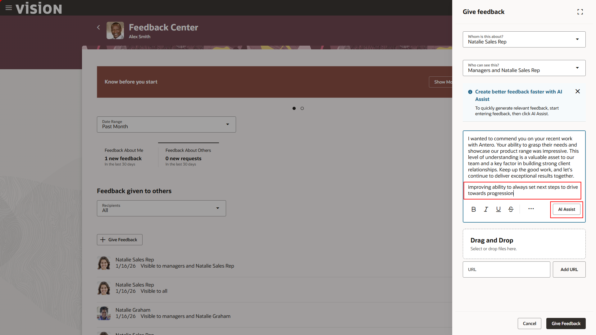
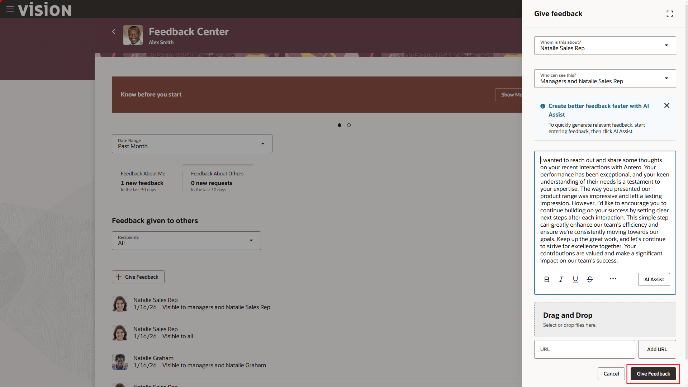

# Generate feedback

## Open Feedback Center

Natalie helped present the loan proposal in Chicago. Use the feedback from that meeting to recognise what she did well and give her one action for the next customer visit.

1. From the sales opportunity, select the **Home** icon in the top bar.

    

2. In **Global Search**, enter `Feedback Center`, then select **Feedback Center - Me**.

    

3. Select **Feedback About Others** to see the feedback you’ve given.

    

4. Under **Feedback given to others**, select **Give feedback**.

    

## Choose Natalie and set visibility

1. In **Whom is this about?**, search for `Natalie` and select **Natalie Sales Rep**.
2. In **Who can see this?**, select **Managers and Natalie Sales Rep**.



## Draft feedback with AI Assist

1. Enter this observation about Natalie’s work with Antero, then select **AI Assist**.

    ```
    <copy>Great job with Antero. You showed ability to understand their needs and know our products well.</copy>
    ```

    

2. Read the draft. Add this coaching note at the bottom of the message, then select **AI Assist** again.

    ```
    <copy>Need to construct next steps more clearly, define action items</copy>
    ```

    The example below shows a draft for a different employee. Keep Natalie selected for this exercise.

    

3. Check whether the revised feedback tells Natalie how to move a deal forward. To make that point more specific, add a blank line below the first paragraph, enter the following phrase, and select **AI Assist**.

    ```
    <copy>improving ability to always set next steps to drive towards progression</copy>
    ```

    

## Review and give feedback

Check that the final message names what Natalie did well and gives her a specific action for her next customer meeting. Confirm **Natalie Sales Rep** and **Managers and Natalie Sales Rep** are still selected, then choose **Give feedback** to post it.



You’ve completed Part 1. You used Deal Advisor to follow up on the sales opportunity, sent Oswald an email about meeting to review the loan terms, and gave Natalie feedback on the visit. The next activity in the scenario concerns a laptop requisition.
