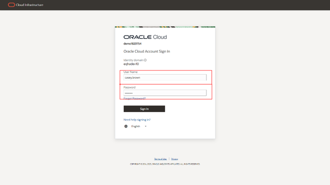
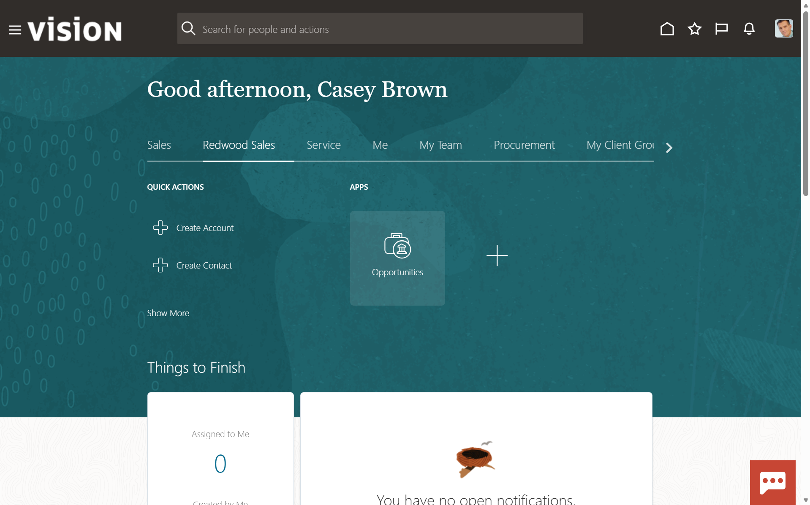
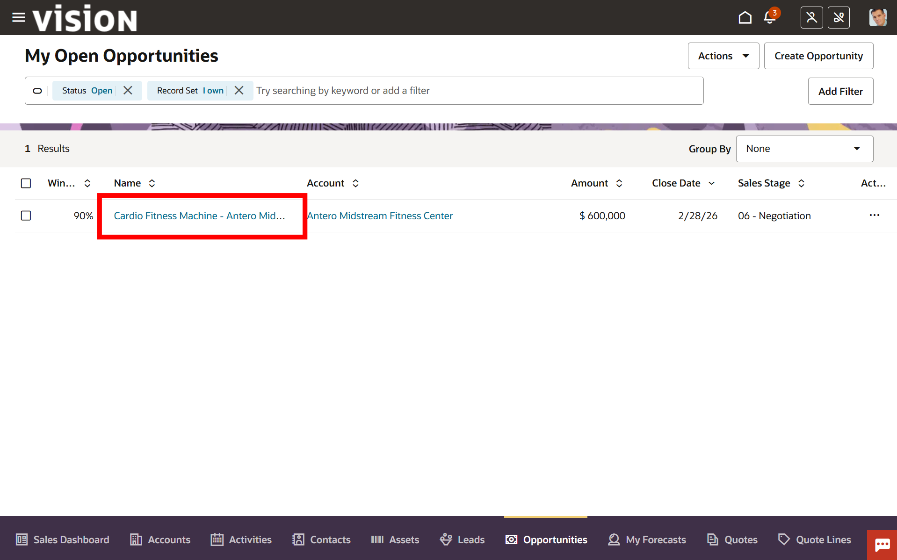
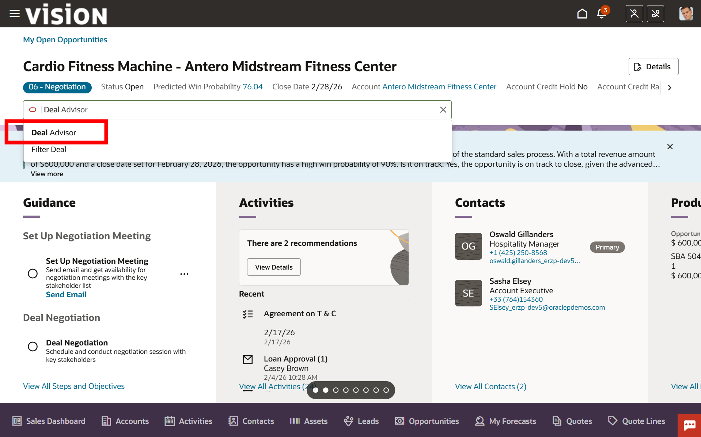
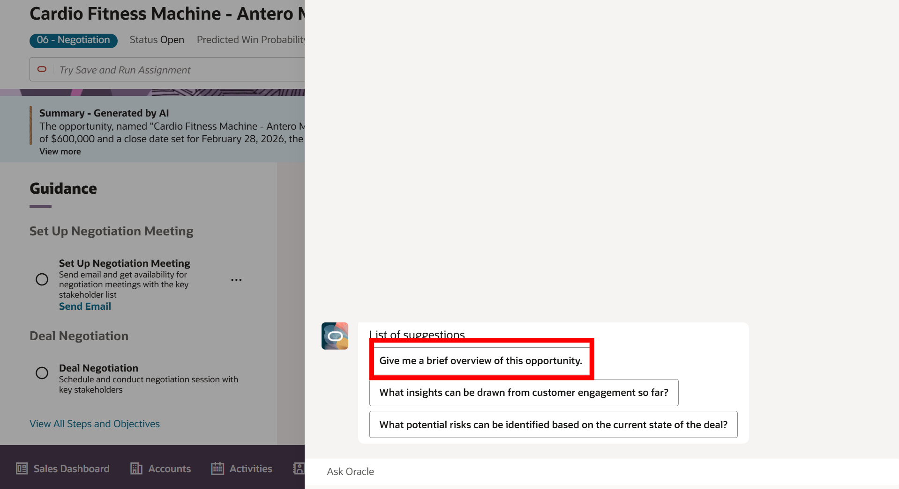
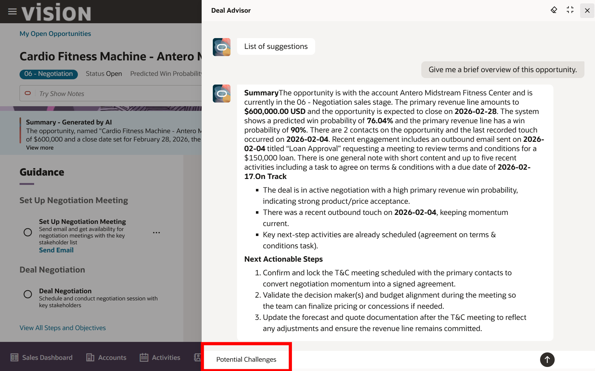
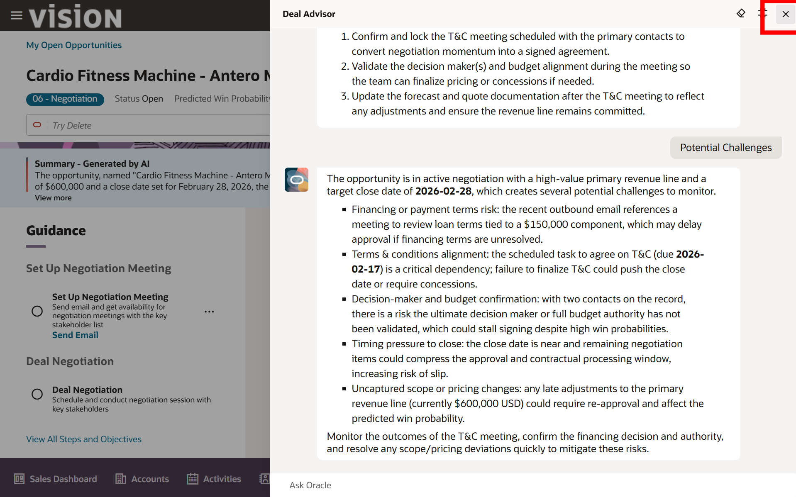
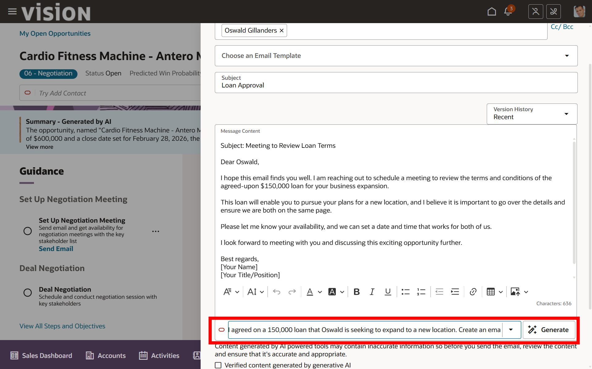

# Sales follow-ups

## Open the sales opportunity

1. Open Oracle CRM Cloud from <a href="../../labs/lab-environments/" target="_blank" rel="noopener">Lab Environments</a>. If you’re already signed in as Casey Brown, go to step 2. Otherwise, sign in with your usual lab password and this user ID.

    ```
    <copy>casey.brown</copy>
    ```

    

2. From the Fusion home page, select **Redwood Sales**, then **Opportunities**.

    

3. In **My Open Opportunities**, select **Cardio Fitness Machine - Antero Midstream Fitness Center**.

    

## Ask Deal Advisor about the opportunity

1. In the opportunity’s search field, enter `Deal Advisor` and select **Deal Advisor** from the results.

    

2. In **List of suggestions**, select **Give me a brief overview of this opportunity.** Read the summary and the recommended next actions. Deal Advisor uses the opportunity’s history and customer engagements to suggest what the team can do next.

    

3. To explore what could delay the deal, enter this follow-up in **Ask Oracle** and submit it.

    ```
    <copy>Potential Challenges</copy>
    ```

    

4. Review the risks and next steps. In the example, the team needs a firm commitment on the loan terms. Select the **X** in the top-right corner of Deal Advisor to return to the opportunity.

    

## Draft and send the follow-up email

1. In the opportunity’s search field, enter `send email` and select **Send Email**.

    

2. In the email to Oswald, leave the email template unselected. Enter `Loan Approval` in **Subject** and `Dear Oswald` in **Message Content**.

3. Paste the following prompt into the AI bar at the bottom of the email editor, then select **Generate**.

    ```
    <copy>Last week, Oswald and I agreed on a 150,000 loan that Oswald is seeking to expand to a new location. Create an email telling Oswald it's time to meet and reviews terms and conditions of that loan.</copy>
    ```

    

4. Read the draft. Check that it asks Oswald to meet about the 150,000 loan for the new location. Replace `[Your Name]` with `Casey Brown`. Select **Verified content generated by generative AI**, then **Send**.

[Continue to Exercise 1-2 · Generate feedback](?lab=generate-feedback)
