# Anomaly insights

## Compare revenue across regions

The period has closed, and Kerry Lane is reviewing product revenue. Use the regional dashboard to spot the change, then open the underlying insight to see what drove it.

1. Open Oracle EPM Cloud from <a href="../../labs/lab-environments/" target="_blank" rel="noopener">Lab Environments</a>. If you’re already signed in as Kerry, continue to step 2. Otherwise, use your assigned Kerry Lane user ID and the EPM password from your trainer. In the guide’s `Kerry.LaneXX` format, replace `XX` with your assigned number.

    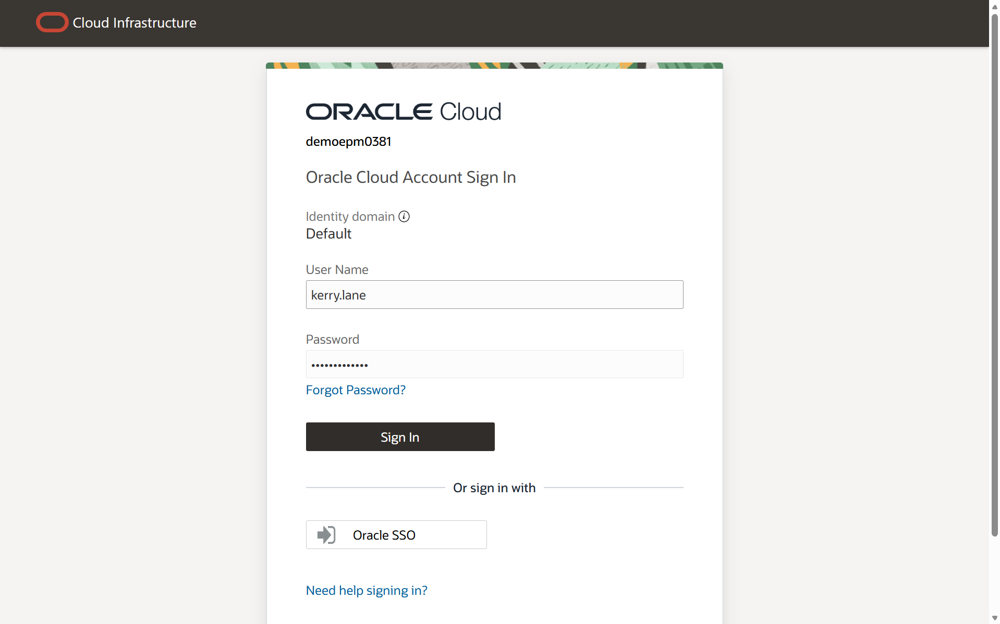

2. From the Planning home page, select **IPM**, then **Insights Data**.

    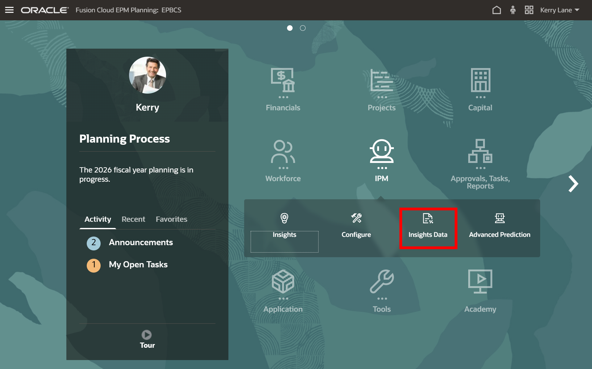

3. On the **Product Revenue Overview** line chart, open **Total Sales Regions**. Select **Sales US – West**, review the trend, then select **Sales US – East**. In this example, West revenue declines while East revenue increases. Select **Insights** on the bar above the dashboard.

    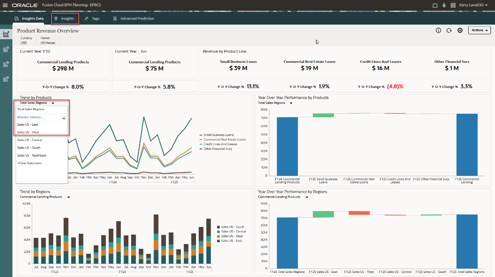

4. Scroll through the insights. Read a few rows and compare their priority, percentage impact, dollar value, and **POV** (the region and product being analysed). The **Type** column distinguishes anomalies from predictions and forecast bias.

    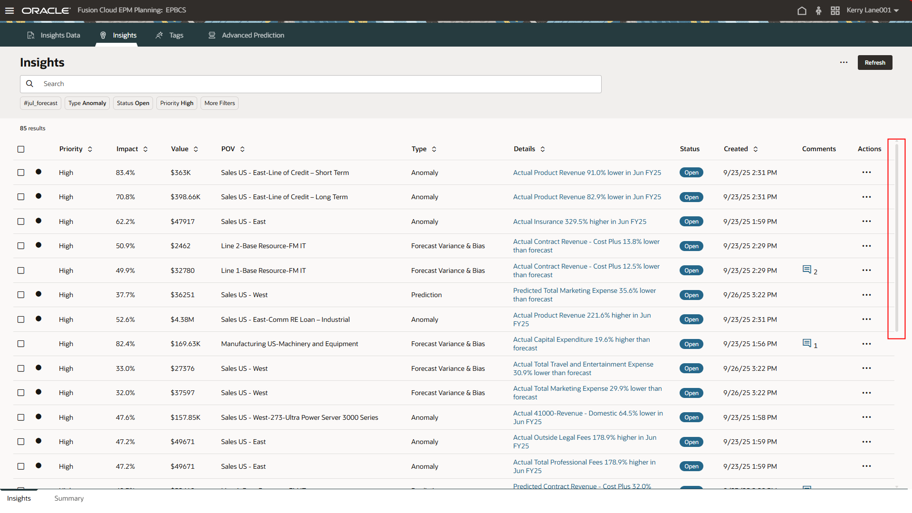

## Investigate the smartphone anomaly

1. In the search box, enter the product below and select **Sales US – East – Smartphones** from the suggestions.

    ```
    <copy>Smartphones</copy>
    ```

    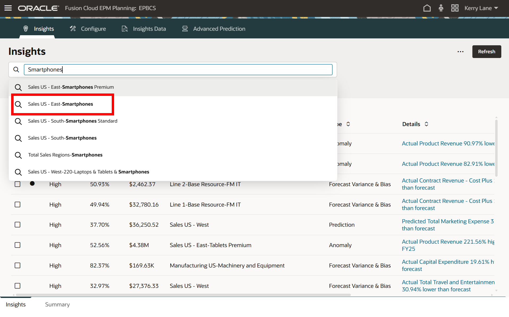

2. Find the **Anomaly** row for **Sales US – East – Smartphones**. In its **Details** column, select the linked description to open the insight.

    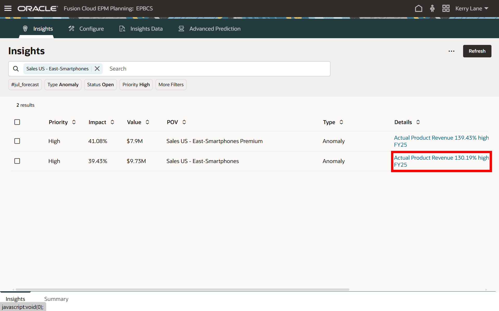

3. Hover over the **star at the far right** of the orange actual-revenue line. Open the explanations panel using the icon in the upper-right corner of the chart, then select **Insights AI**. Compare the narrative with the chart. In the example, June FY25 revenue was **$17.21 million**, compared with a periodic average of **$7.48 million**.

    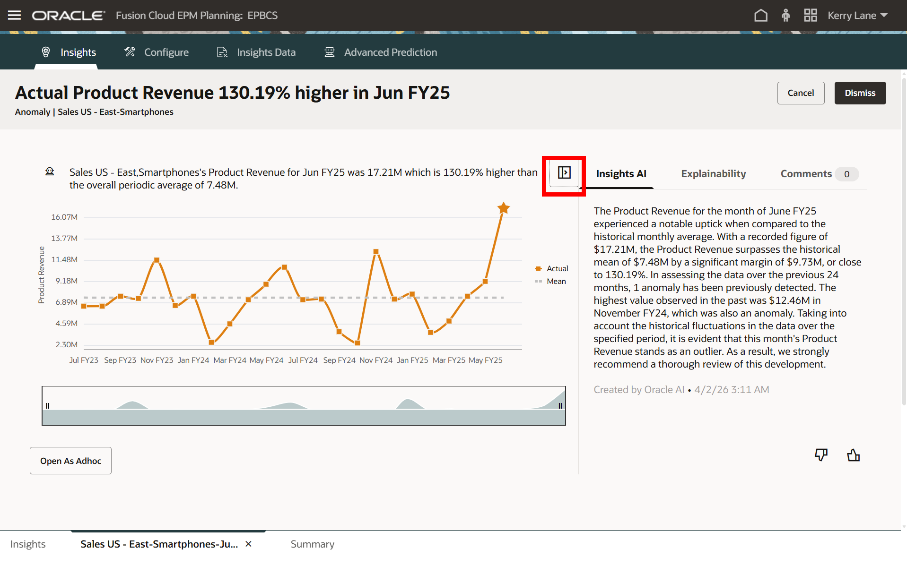

## Generate a summary for the review

1. Select **Insights** at the bottom left to return to the list. Select the checkbox for the **Sales US – East – Smartphones** anomaly you just reviewed. Open **Actions** above the list and select **Summarize**.

    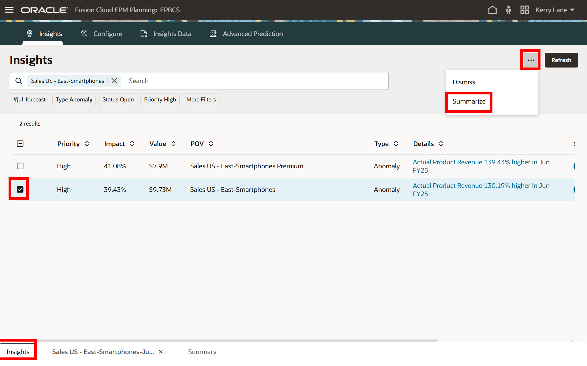

2. Give the summary a name you can find again. For example, use `XXX Smartphones` and replace `XXX` with your initials. Set **Insight Type** to **Anomaly**. Check the prefilled product, entity, and point of view, then select **Run**.

    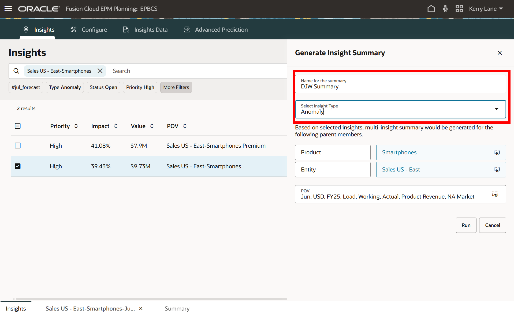

3. Open the **Summary** tab at the bottom of the page. The result may take a few seconds to appear. Select your summary by name and read which products or entities contributed to the overall change. Close the summary text with **X** when you finish.

    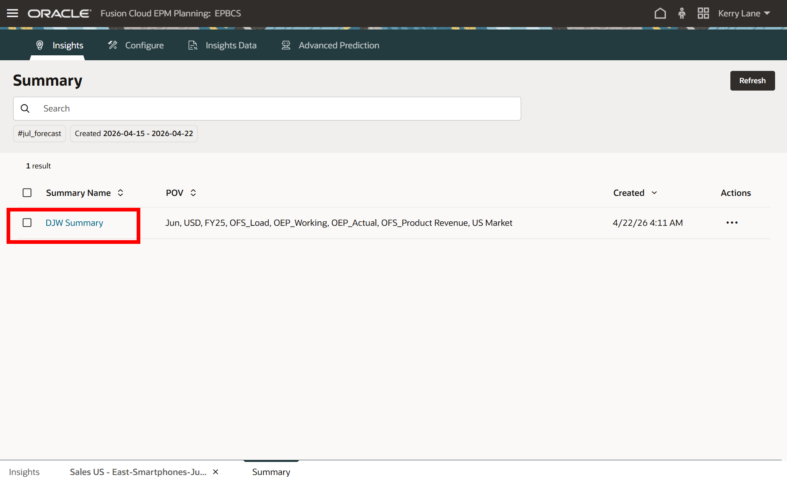

## Comment and ask a colleague to review

1. Return to **Insights** at the bottom left and select the same anomaly’s **Details** link again.

    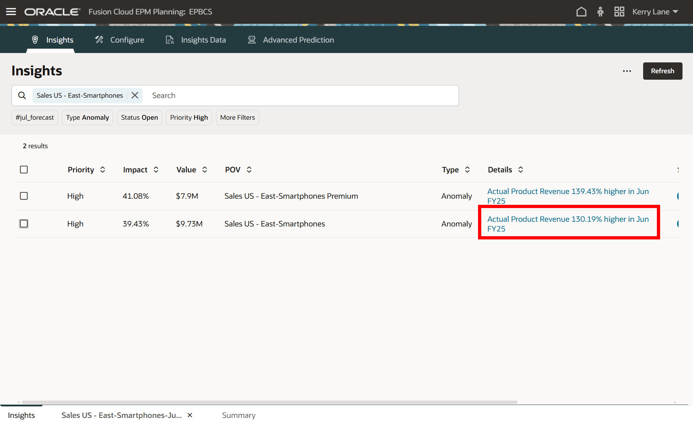

2. Open the panel at the upper right of the chart and select **Comments**. Paste the example below into **Enter Comments**, or write a similar observation with hashtags. Select the **Post** icon beneath the field. The hashtags give colleagues a way to filter related insights.

    ```
    <copy>The new #AIdriven targeted #marketcampaign proved to be a big hit with significant sales in Smartphones.</copy>
    ```

    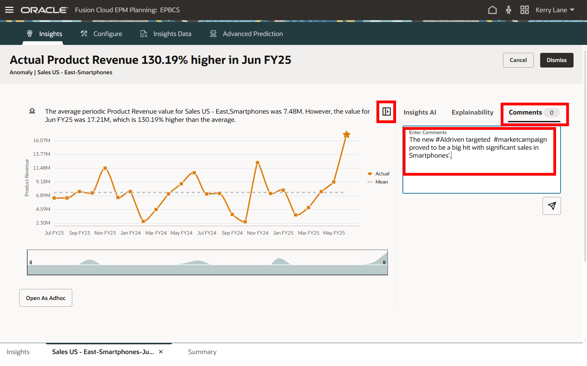

3. In a new comment, type `@S`, then choose **Susan Chang** from the suggestions to tag her. Ask her to review the East region’s smartphone result and post the comment. Select **Home** in the upper-right corner to return to Planning.

    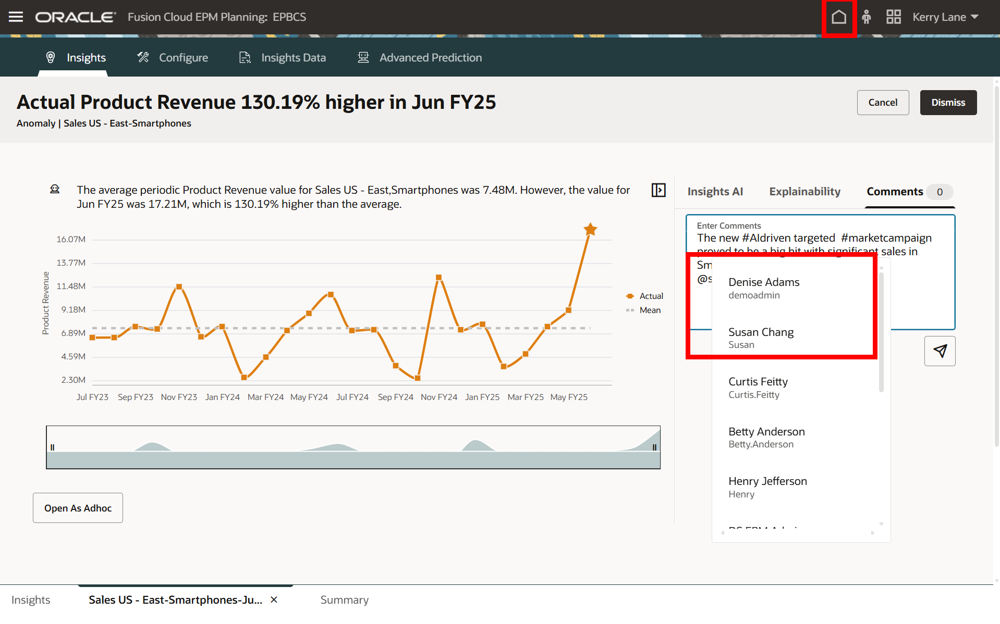

## Lab complete

You checked a laptop request against procurement policy, reviewed and exported evidence for a role certification, and used an EPM insight to explain a regional revenue spike. Your named summary and tagged comment give Susan the figures and context she needs to review the result.
