# Requisition a new laptop

## Open Purchase Requisitions

Casey needs a replacement laptop after the Chicago trip. Use the Procurement Policy Advisor to find out what he can order, then check an existing laptop request in the lab. The catalogue order has already been placed for this exercise.

1. In Oracle Fusion, sign in as Casey Brown if needed and select **Home** in the top bar. If you finished Part 1, you’ll see the Home icon above Feedback Center.

    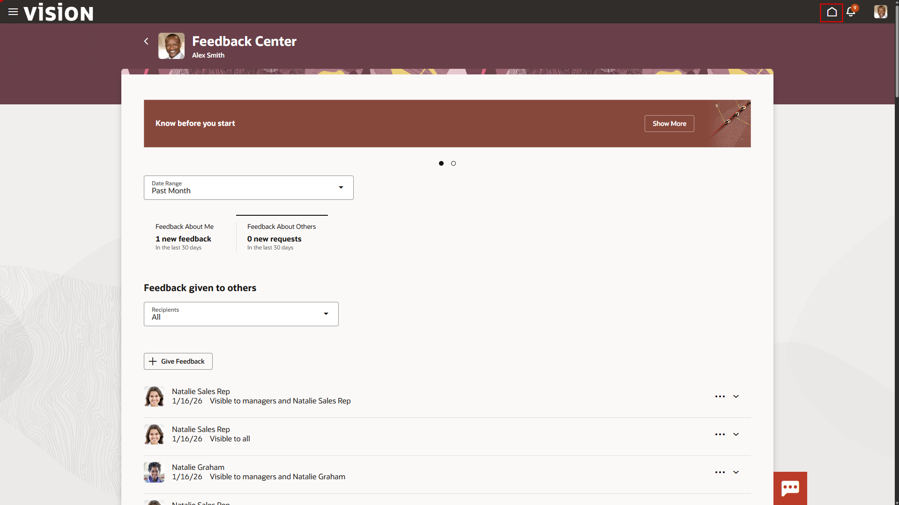

2. On the home page, select **Procurement**, then **Purchase Requisitions**. The landing page shows recent requisitions and their status, with a search field for the catalogue.

    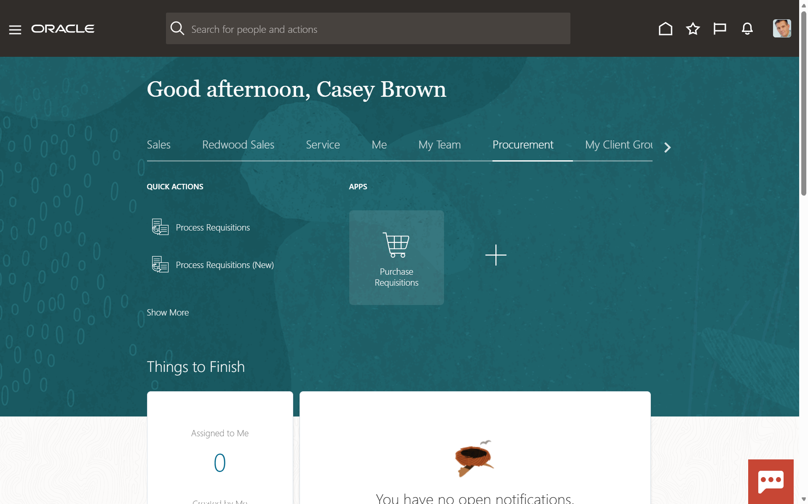

## Ask what the laptop policy allows

1. Find the **Procurement Policy Advisor** banner and select **Ask Oracle**.

    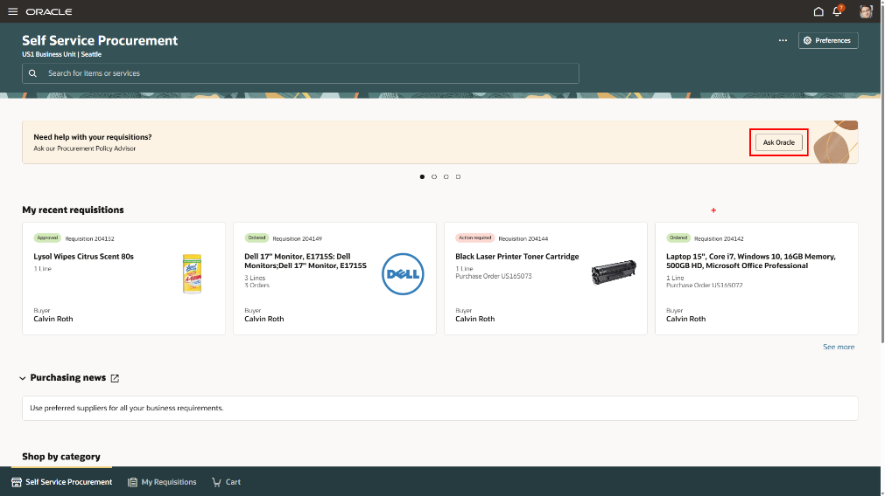

2. Select the suggested question below, or paste it into **Ask Oracle**.

    ```
    <copy>How do I order a nonstandard laptop?</copy>
    ```

    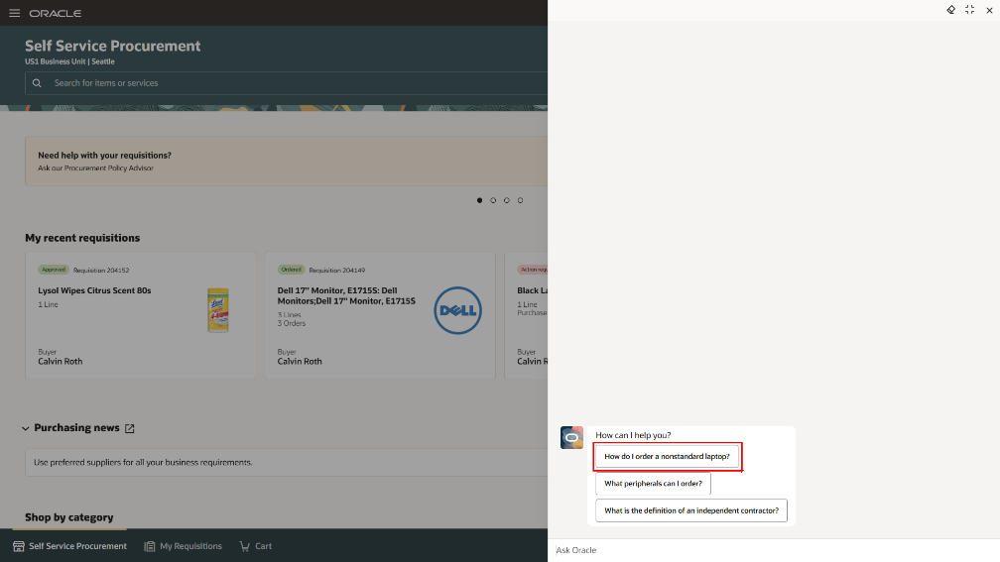

3. Read the ordering steps in the answer. Select **Sources** beneath the response to see which policy documents the advisor used.

    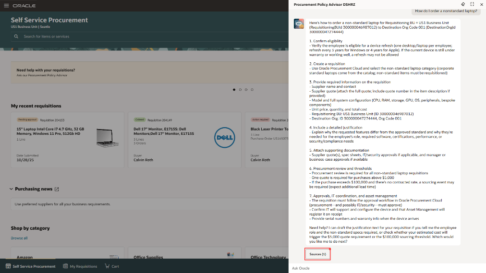

4. Select the first source and read the policy excerpt that supports the answer.

    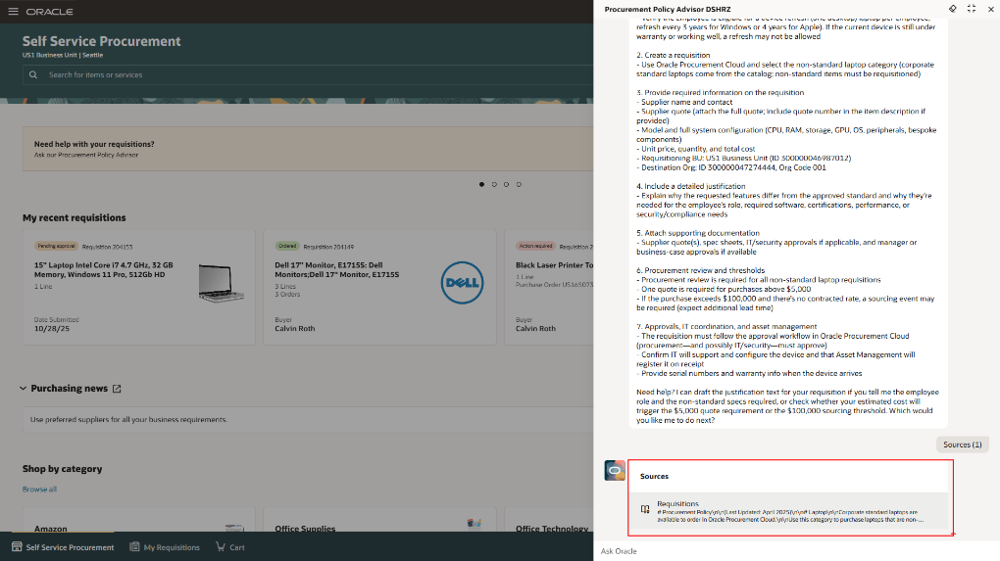

5. Use the same conversation to find out whom Casey should contact. Enter the following question and send it.

    ```
    <copy>Who is my Procurement Contact?</copy>
    ```

    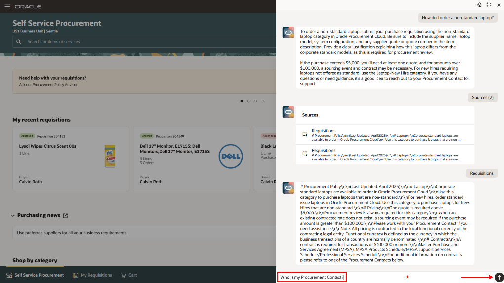

6. Read the reply, then select the **X** in the upper-right corner of the chat to return to Self Service Procurement.

    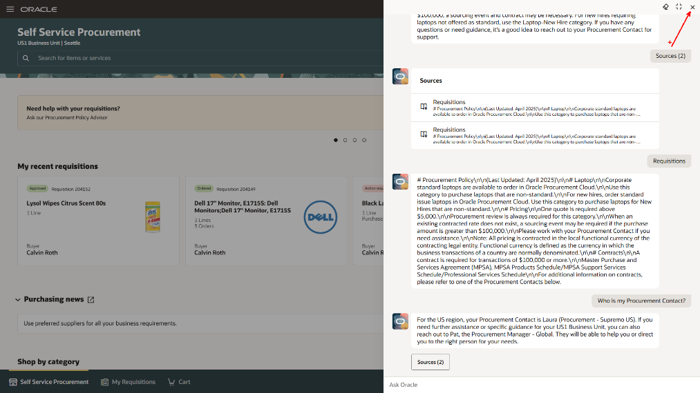

## Check the laptop’s approval status

1. Select the **second dot** beneath the banner to switch advisors.

    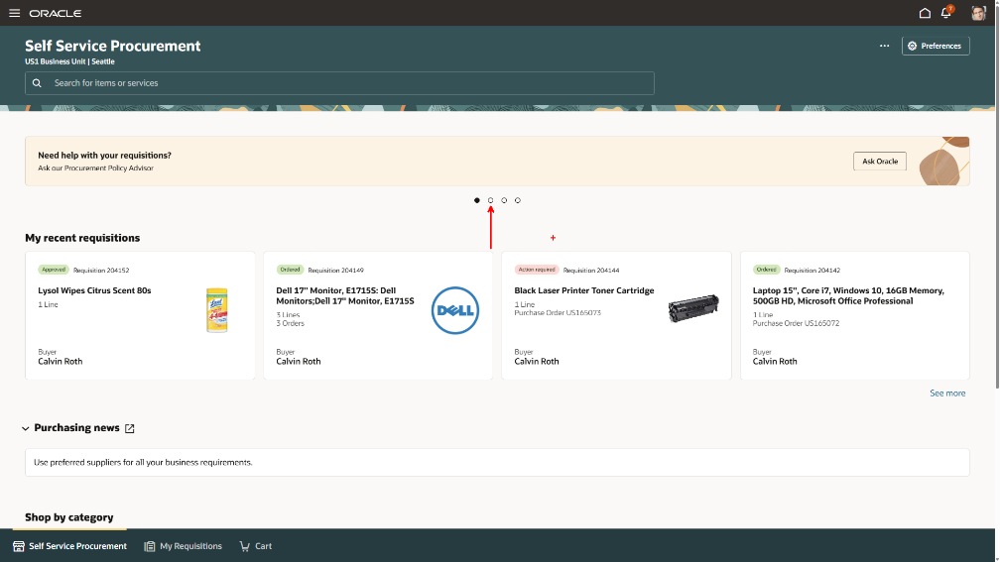

2. When the **Requisition Status Advisor** banner appears, select **Ask Oracle**.

    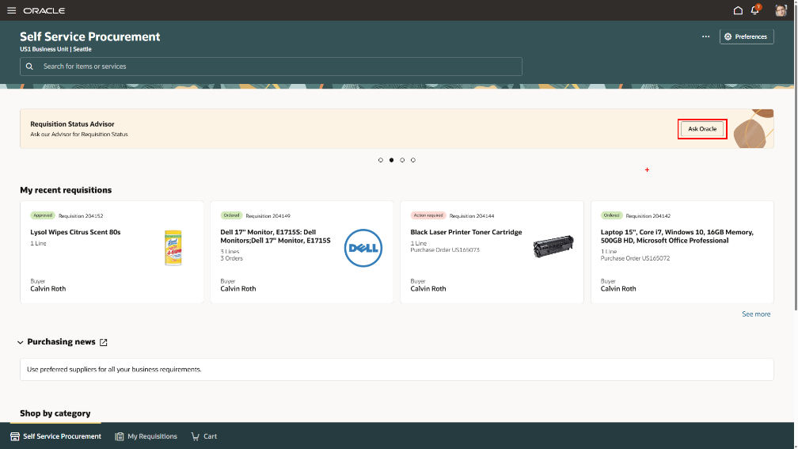

3. Select the pending-approval suggestion or send the following question. If a status question gets no response, close the advisor, reopen it, and send the question again.

    ```
    <copy>What requisitions are in pending approval status?</copy>
    ```

    

4. Find the laptop in the reply. In the example, requisition **204153** is the 15-inch laptop awaiting approval. If the answer includes a **here** link, you can open the requisition, review it, then close that tab and return to the advisor.

    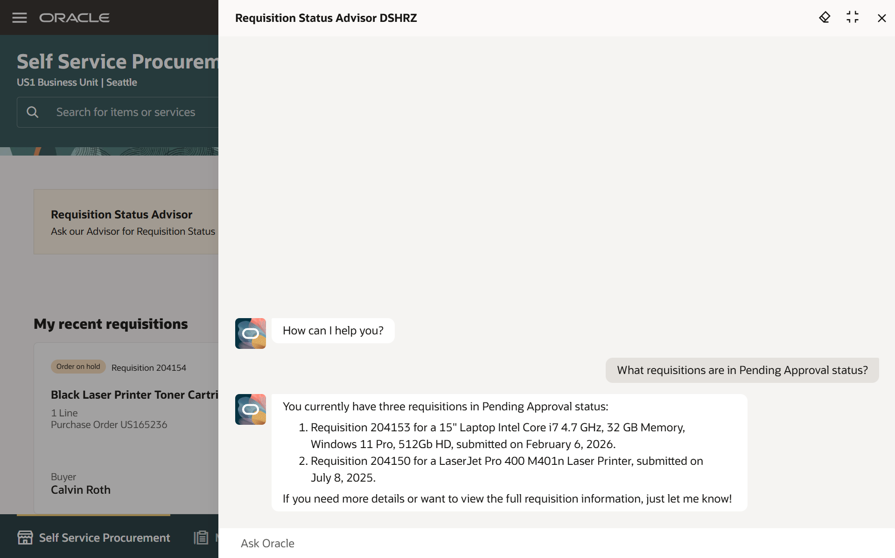

## Open a requisition that is on hold

1. Ask for requisitions that need attention. In the example, **204154** is a black laser printer toner cartridge whose order is on hold.

    ```
    <copy>what reqs are on hold</copy>
    ```

    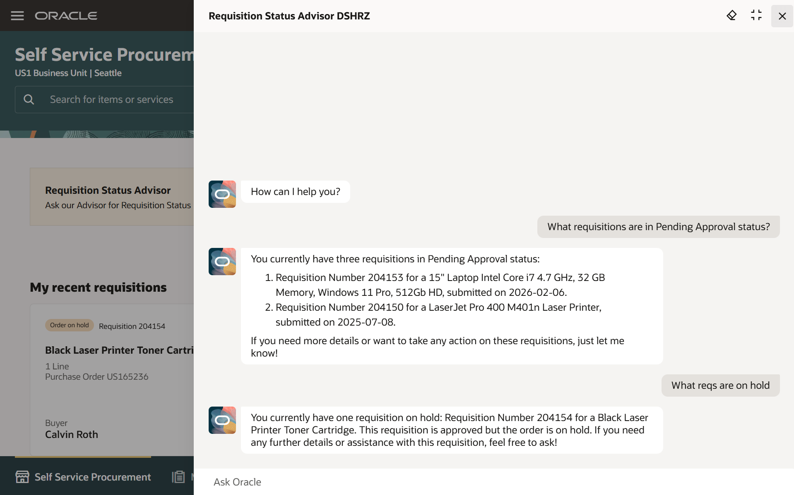

2. Ask for that requisition, then open the link in the answer.

    ```
    <copy>Show me requisition 204154</copy>
    ```

    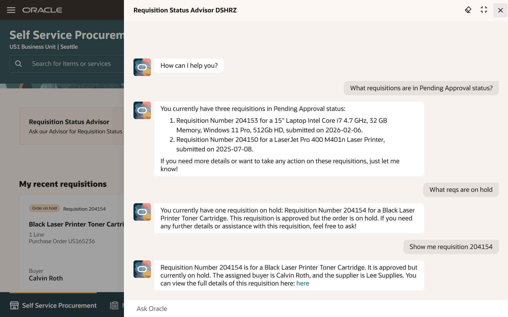

3. Check the **Order on hold** status and the item under **Lines**. Optionally expand **More information** or open the purchase order to see the supplier and line details.

    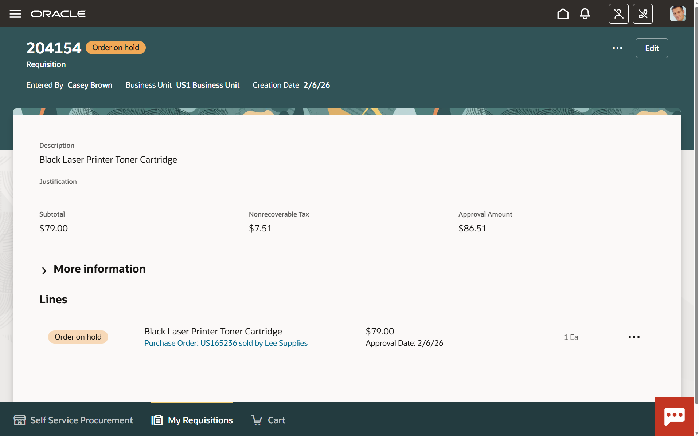

[Continue to Exercise 1-4 · Risk management and separation of duties](?lab=separation-of-duties)
