# Risk management and separation of duties

## Open the certifier worksheet

As part of the quarterly review, Casey needs to check who has access to purchasing functions. You’ll review one person’s role, inspect the evidence for keeping it, and cancel the practice decision so another participant can use the same record.

1. From the requisition, select **Home** in the top bar.

    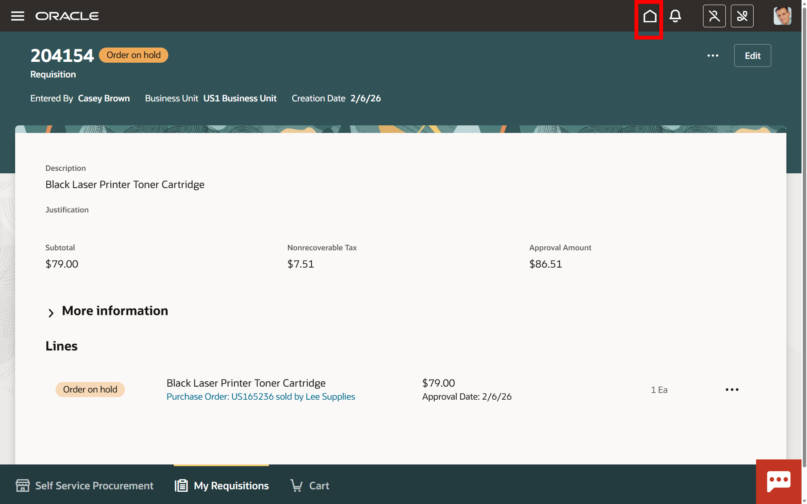

2. Select **Risk Management**, then **Access Certifications**.

    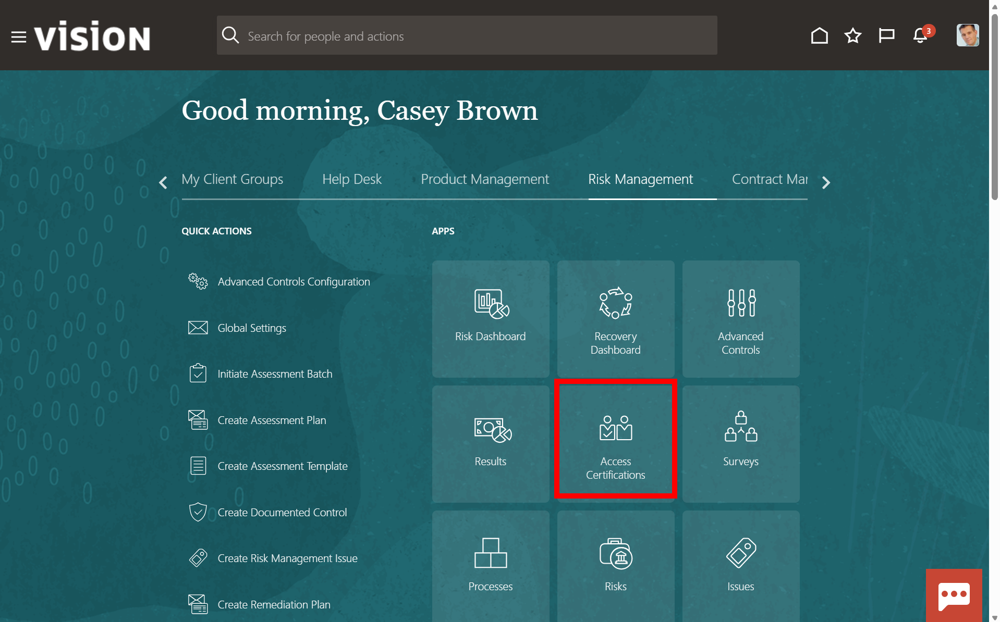

3. Find the **AI Test Drive – Procure to Pay** row. At the far right of that row, open the **Links** dropdown and select **Certifier Worksheet**.

    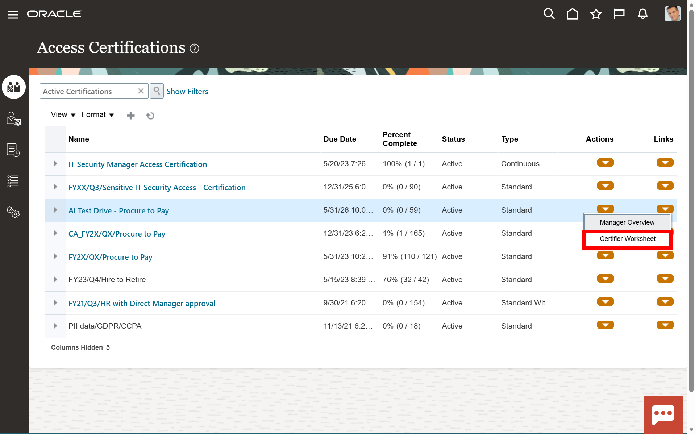

## Review the role and export the evidence

1. Choose a row whose **Action** is **Review**. Note the **User Name**, then select the linked **Role Name** in that row. The example uses the **Procurement Manager** role.

    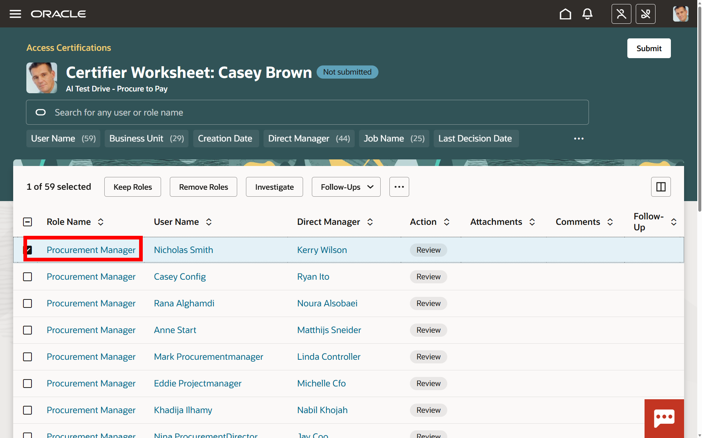

2. Read **Highlights** in the **Security briefing**. Identify what the role lets this person do, how many users hold it, and any access incidents that need consideration.

    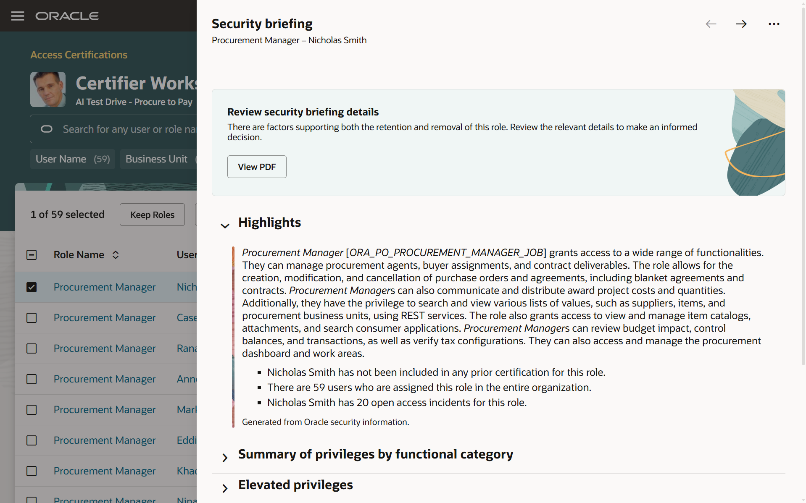

3. Scroll down and expand **Complete list of privileges**. Compare a specific privilege with the summary. You can also expand **Usage in the organization** and **Inherent risks and incident history** to investigate who uses the role and what risks have been recorded.

    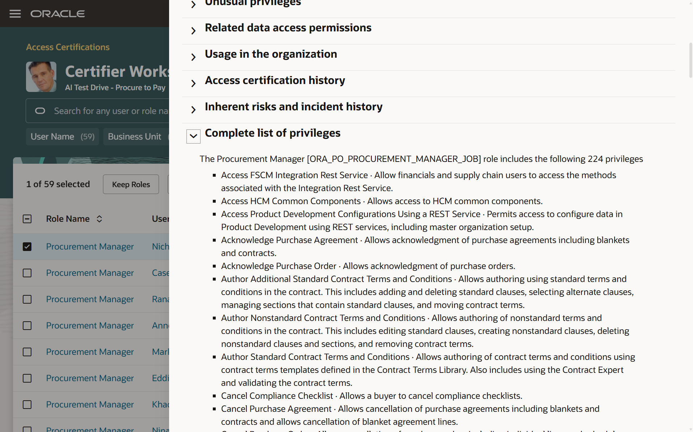

4. Scroll to the top of the security briefing and select **View PDF**.

    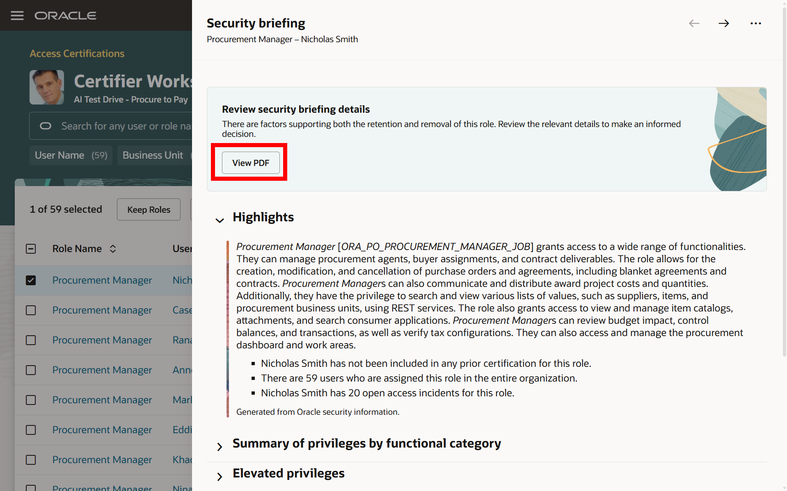

5. Open the downloaded report. Check the role, the assigned user, and the **Generated by AI** date on the first page. The contents list links the privilege, usage, and risk sections in one report.

    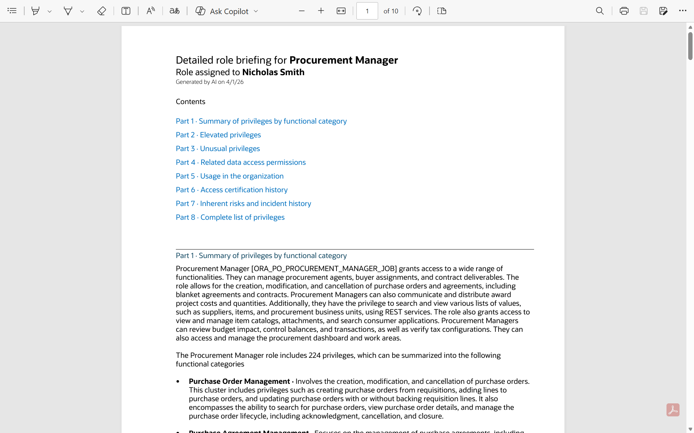

6. Return to the **Risk Management** browser window. In the briefing’s upper-right corner, open the **…** menu and select **Close** to return to the worksheet.

    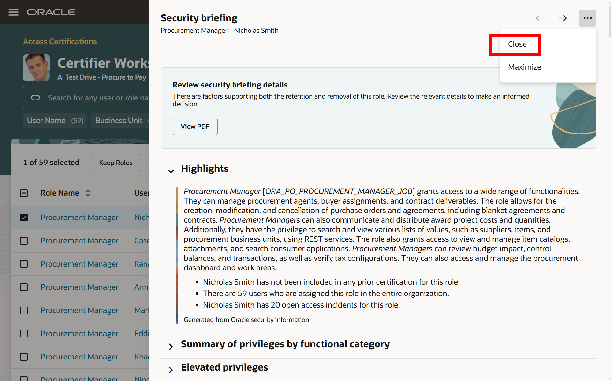

## Draft a certification decision

1. Select the checkbox for the **same user and role** you just reviewed. Select **Keep Roles** above the table.

    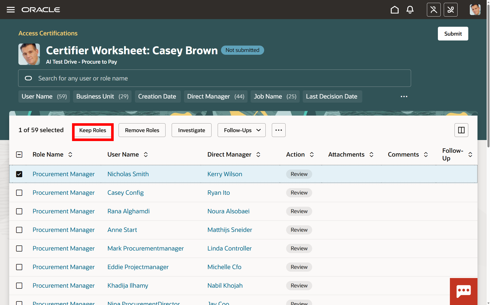

2. In **Comment**, enter a short reason. For a role that authorises invoice creation, you could use the example below. Adapt it to the privileges you found, then select **Generate** to see the suggested wording.

    ```
    <copy>retain invoice creation access</copy>
    ```

    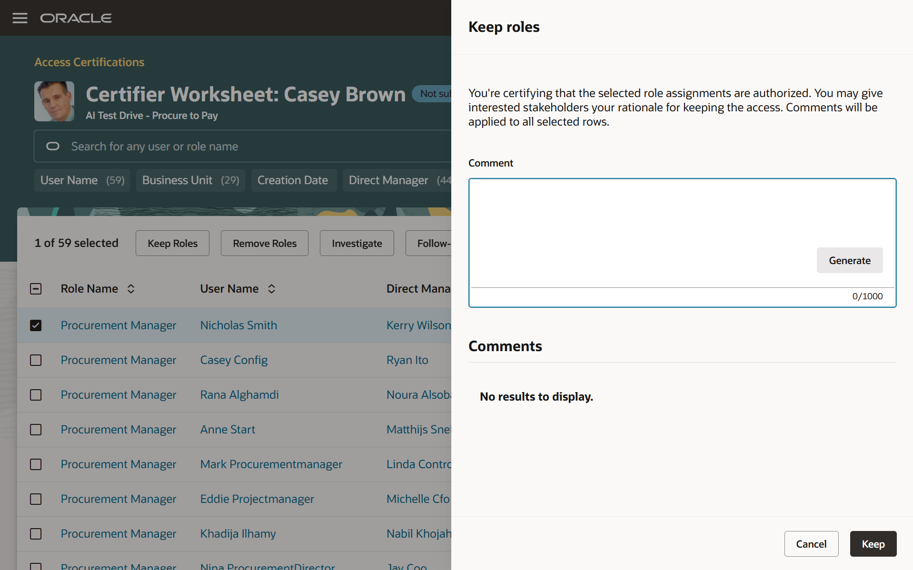

3. Read the suggestion, then select **Cancel**. This leaves the assignment available for the next participant. The screenshot below shows how a saved decision would appear in the **Action** and **Comments** columns.

    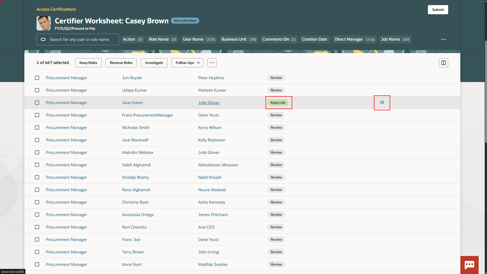

[Continue to Exercise 1-5 · Anomaly insights](?lab=anomaly-insights)
