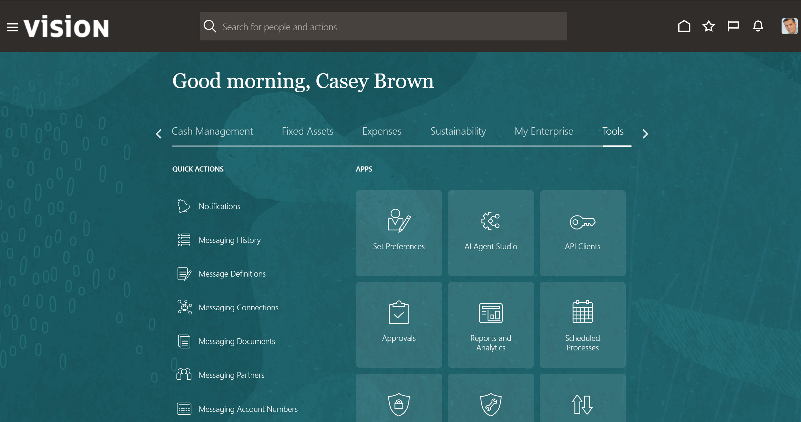
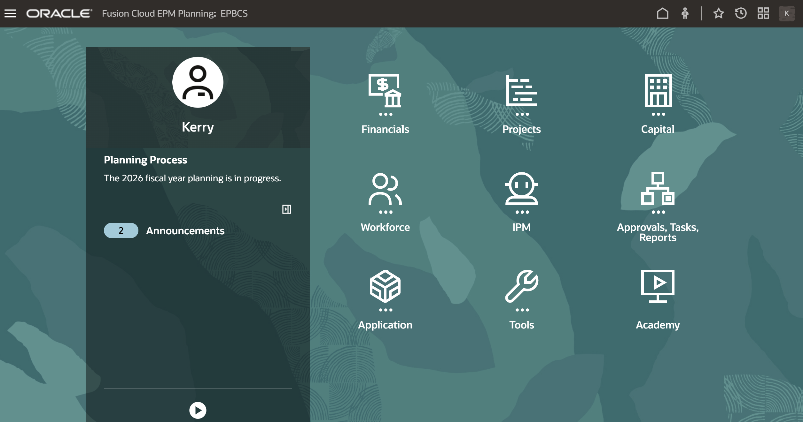

# Environments

## Sign-in details

Your trainer will provide the passwords for both environments separately.

### Fusion

Use this username to [sign in to Fusion](https://fa-erzr-saasfademo1.ds-fa.oraclepdemos.com/fscmUI/faces/FuseWelcome?fndThemeName=Vision_Default).

```
<copy>Casey.Brown</copy>
```

### EPM

Replace `XX` with the number your trainer assigns, then use that username to [sign in to EPM](https://epm10381fcc-demoepm0381.epm.eu-frankfurt-1.ocs.oraclecloud.com/epmcloud).

```
<copy>Kerry.LaneXX</copy>
```

## Fusion home page



## EPM home page


